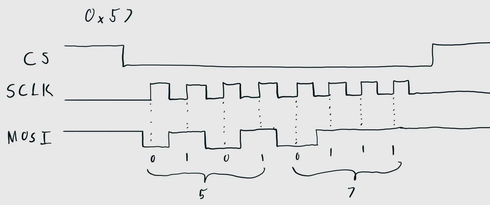

# ece528_fall26_homework3

### The MSP432 uses the eUSCI_A modules for UART communication. Describe the function of the following registers:
* UCAxBRW (Baud Rate Control Word)    
<ins>Answer</ins> - Clock prescaler setting of the baud-rate generator. Bits 15-0
* UCAxMCTLW (Modulation Control Word)    
<ins>Answer</ins> - Configures the baud-rate modulation. Baud-rate modulation is a system that regularly adds a removes a little time to one bit period to account for decimal value lost during the operation clock/baud-rate.
* UCAxCTLW0 (Control Word 0)    
<ins>Answer</ins> - Controls multiple aspects of the UART communication including but not limited to: Parity, bit order, character length, number of stop bits, synchronous / asynchronous, clock source, interrupts...
* UCAxRXBUF (Receive Buffer)    
<ins>Answer</ins> - The receive-data buffer is user accessible and contains the last received character from the receive shift register.
* UCAxTXBUF (Transmit Buffer)    
<ins>Answer</ins> - The transmit data buffer is user accessible and holds the data waiting to be moved into the transmit shift register and transmitted on UCAxTXD.

### What is the purpose of the UCAxSTATW status register in the UART module? Which bits indicate the following?
<ins>Answer</ins> - The UACxSTATW register contains flags to track the status of the UART.
* Whether the UART module is currently transmitting    
<ins>Answer</ins> - 0
* Whether a framing, parity, or overrun error has occurred    
<ins>Answer</ins> - 6,5,4
* Whether the RX buffer contains unread data    
<ins>Answer</ins> - 1

### Assume that the eUSCI_A3 module is using SMCLK as its clock source, which has a frequency of 12 MHz. Calculate the value that is needed to be written to the UCAxBRW register to configure the eUSCI_A3 module for 115200 baud.
<ins>Answer</ins> - 12*10^6 / 115200 = 104, but with oversampling (UCOS16 = 1) then 104.17 / 16 = 6

### Write a function named UART2_Init that configures the eUSCI_A2 module for the following settings:
* Baud Rate: 115200    
<ins>Answer</ins> - eUSCI_A2->BRW
* Data Length: 8 bits    
<ins>Answer</ins> - UC7BIT = 0
* Parity: None    
<ins>Answer</ins> - UCPEN = 0
* Stop Bits: 1    
<ins>Answer</ins> - UCSPB = 0
* Bit Order Most Significant Bit (MSB) First    
<ins>Answer</ins> - EUSCI_A_CTLW0_MSB (UCMSB = 1)
* Clock Source: SMCLK (12 MHz)    
<ins>Answer</ins> - EUSCI_A_CTLW0_SSEL__SMCLK (UCSSEL = 0b10)
* Pins: P3.2 (UCA2TXD) and P3.3 (UCA2RXD)
<ins>Answer</ins> - SEL0 |= 0x0C; SEL1 &= ~0x0C
```
void UART2_Init(void)
{
    eUSCI_A2->CTLW0 = 0x2081; // 0010_0000_1000_0001

    P3->SEL0 |= 0x0C;
    P3->SEL1 &= ~0x0C;

    eUSCI_A2->BRW = 104;
    eUSCI_A2->MCTLW = 0;

    eUSCI_A2->CTLW0 &= ~0x0001;
    EUSCI_A2->IE &= ~0x000F;
}
```

### Suppose that you have a main program that is transmitting data using the eUSCI_A2 module given the configuration in part (a). Draw the waveform for the UART TX data line if the main program is transmitting two bytes: 0xF1 followed by 0x55. Clearly label the start bits, data bits, and stop bits. Assume that there is a 50 ms delay between the two bytes.


### What is the function of the eUSCI_B module? How does SPI communication differ from UART communication in terms of:
<ins>Answer</ins> - The A module controls UART and SPI, while the B module controls SPI and I2C
* Synchronization    
<ins>Answer</ins> - SPI is synchronous, UART is asynchronous
* Clocking    
<ins>Answer</ins> - UART uses a system clock with a baud rate to modify the bit length, SPI allows the master to generate the clock signal which the slave uses.
* Signaling    
<ins>Answer</ins> - UART has 2 signal lines, TX and RX whereas SPI uses MOSI, MISO, SCLK, and CS. UART needs new set of lines for each connected device while SPI only needs to have one of each line and one CS line per slave.
* Data Framing    
<ins>Answer</ins> - UART has start, stop, and parity bits, SPI sends data with no frame.

### Explain the role of the following SPI signals:
* SCLK    
<ins>Answer</ins> - This line is used by the master to send a clock signal to the slaves.
* CS    
<ins>Answer</ins> - Chip Select, controls which slave is being communicated with.
* MISO    
<ins>Answer</ins> - Master In Slave Out, data from slave to master.
* MOSI    
<ins>Answer</ins> - Master Out Slave In, data from master to slave.

### What happens if multiple SPI peripheral devices have their CS line asserted simultaneously on the MSP432?
<ins>Answer</ins> - The outputs from the slaves conflict with each other on the MISO line, causing shorts and junk signals.

### Briefly describe the function of the UCBxCTLW0 (Control Word 0) register from the eUSCI_B module.
<ins>Answer</ins> - The UCB control word 0 register controls the configuration of the SPI and I2C communication methods. They allow configuration of the clock, bit order character length, synchronous / asynchronous modes, own addressing mode, slave addressing mode, whether to transmit or receive, when to transmit NACK, START, and STOP, and much more.

### Which bits need to be cleared or set in the UCBxCTLW0 register to configure the SPI mode used by the eUSCI_B module? Provide a description of each bit.
<ins>Answer</ins> - To select SPI mode, UCSYNC (bit 8) must be set to 1 and UCMODEx (bits 10,9) must be 00, 01, or 10. UCMST (11) sets master or slave, UCCKPH (15) and UCCKPL (14) set the clock phase and polarity, UCMSB (13) selects bit order, UC7BIT (12) selects 7- or 8-bit characters, UCSSELx (7,6) picks the clock source in master mode, UCSTEM (1) controls the STE pin in 4-pin master mode, and UCSWRST (0) must be 1 while configuring and cleared to enable the module.

### Which field in the UCBxCTLW0 register selects the clock source used by the eUSCI_B module? Provide the values used and the corresponding clock sources.
<ins>Answer</ins> - Bits 7 and 6 are the UCSSELx field which selects the clock source. 00 is reserved, 01 is ACLK which is the Auxiliary CLocK, 10 and 11 select the Subsystem Master CLocK (SMCLK).

### Write a function named EUSCI_B0_SPI_Init that configures the eUSCI_B0 module for SPI communication with the following settings:
* SPI Mode: 0    
<ins>Answer</ins> - UCCKPL = 0 and UCCKPH = 1
* Data Length: 8 bits    
<ins>Answer</ins> - UC7BIT = 0
* Bit Order: Most Significant Bit (MSB) First    
<ins>Answer</ins> - UCMSB = 1
* Clock Source: SMCLK (12 MHz)    
<ins>Answer</ins> - UCSSELx = 10
* SPI Clock Frequency: 1 MHz    
<ins>Answer</ins> - UCB0BRW = 12
* SPI format: 3-wire SPI    
<ins>Answer</ins> - UCMODEx = 00, UCSYNC = 1
* SPI Pins:
* <i>P1.5: SCLK (UCB0CLK)</i>
* <i>P1.6: MOSI (UCB0SIMO)</i>
* <i>P1.7: MISO (UCB0SOMI)</i>
* <i>P9.0: Active Low Chip Select (GPIO)</i>    
<ins>Answer</ins> - 
```
void EUSCI_B0_SPI_Init(void)
{
    EUSCI_B0->CTLW0 = 0xA981; // 1010_1001_1000_0001
    EUSCI_B0->BRW = 12;

    P1->SEL0 |= 0xE0;
    P1->SEL1 &= ~0xE0;

    P9->SEL0 &= ~0x01;
    P9->SEL1 &= ~0x01;
    P9->DIR  |= 0x01;
    P9->OUT  |= 0x01;

    EUSCI_B0->CTLW0 &= ~EUSCI_B_CTLW0_SWRST;
    EUSCI_B0->IE &= ~(EUSCI_B_IE_RXIE | EUSCI_B_IE_TXIE);
}
```

### If a main program transmits one byte with a value of 0x57, draw the waveforms for:
* Chip Select (Active Low)    
* SCLK    
* MOSI    

