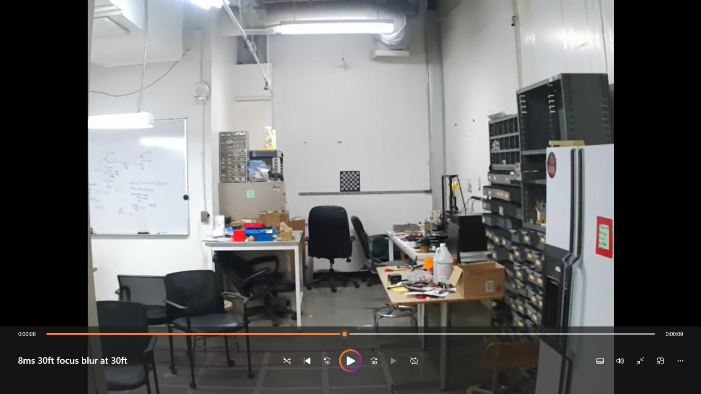

# ece528_fall26_homework3

### The MSP432 uses the eUSCI_A modules for UART communication. Describe the function of the following registers:
* UCAxBRW (Baud Rate Control Word)    
<ins>Answer</ins> - 
* UCAxMCTLW (Modulation Control Word)    
<ins>Answer</ins> - 
* UCAxCTLW0 (Control Word 0)    
<ins>Answer</ins> - 
* UCAxRXBUF (Receive Buffer)    
<ins>Answer</ins> - 
* UCAxTXBUF (Transmit Buffer)    
<ins>Answer</ins> - 

### What is the purpose of the UCAxSTATW status register in the UART module? Which bits indicate the following?
* Whether the UART module is currently transmitting    
<ins>Answer</ins> - 
* Whether a framing, parity, or overrun error has occurred    
<ins>Answer</ins> - 
* Whether the RX buffer contains unread data    
<ins>Answer</ins> - 

### Assume that the eUSCI_A3 module is using SMCLK as its clock source, which has a frequency of 12 MHz. Calculate the value that is needed to be written to the UCAxBRW register to configure the eUSCI_A3 module for 115200 baud.
<ins>Answer</ins> - 

### Write a function named UART2_Init that configures the eUSCI_A2 module for the following settings:
* Baud Rate: 115200    
<ins>Answer</ins> - 
* Data Length: 8 bits    
<ins>Answer</ins> - 
* Parity: None    
<ins>Answer</ins> - 
* Stop Bits: 1    
<ins>Answer</ins> - 
* Bit Order Most Significant Bit (MSB) First    
<ins>Answer</ins> - 
* Clock Source: SMCLK (12 MHz)    
<ins>Answer</ins> - 
* Pins: P3.2 (UCA2TXD) and P3.3 (UCA2RXD)    
<ins>Answer</ins> - 

### Suppose that you have a main program that is transmitting data using the eUSCI_A2 module given the configuration in part (a). Draw the waveform for the UART TX data line if the main program is transmitting two bytes: 0xF1 followed by 0x55. Clearly label the start bits, data bits, and stop bits. Assume that there is a 50 ms delay between the two bytes.

### What is the function of the eUSCI_B module? How does SPI communication differ from UART communication in terms of:
* Synchronization    
<ins>Answer</ins> - 
* Clocking    
<ins>Answer</ins> - 
* Signaling    
<ins>Answer</ins> - 
* Data Framing    
<ins>Answer</ins> - 

### Explain the role of the following SPI signals:
* SCLK    
<ins>Answer</ins> - 
* CS    
<ins>Answer</ins> - 
* MISO    
<ins>Answer</ins> - 
* MOSI    
<ins>Answer</ins> - 

### What happens if multiple SPI peripheral devices have their CS line asserted simultaneously on the MSP432?
<ins>Answer</ins> - 

### Briefly describe the function of the UCBxCTLW0 (Control Word 0) register from the eUSCI_B module.
<ins>Answer</ins> - 

### Which bits need to be cleared or set in the UCBxCTLW0 register to configure the SPI mode used by the eUSCI_B module? Provide a description of each bit.
<ins>Answer</ins> - 

### Which field in the UCBxCTLW0 register selects the clock source used by the eUSCI_B module? Provide the values used and the corresponding clock sources.
<ins>Answer</ins> - 

### Write a function named EUSCI_B0_SPI_Init that configures the eUSCI_B0 module for SPI communication with the following settings:
* SPI Mode: 0    
<ins>Answer</ins> - 
* Data Length: 8 bits    
<ins>Answer</ins> - 
* Bit Order: Most Significant Bit (MSB) First    
<ins>Answer</ins> - 
* Clock Source: SMCLK (12 MHz)    
<ins>Answer</ins> - 
* SPI Clock Frequency: 1 MHz    
<ins>Answer</ins> - 
* SPI format: 3-wire SPI    
<ins>Answer</ins> - 
* SPI Pins:
* <i>P1.5: SCLK (UCB0CLK)</i>
* <i>P1.6: MOSI (UCB0SIMO)</i>
* <i>P1.7: MISO (UCB0SOMI)</i>
* <i>P9.0: Active Low Chip Select (GPIO)</i>    
<ins>Answer</ins> - 

### If a main program transmits one byte with a value of 0x57, draw the waveforms for:
* Chip Select (Active Low)    

* SCLK    

* MOSI    

